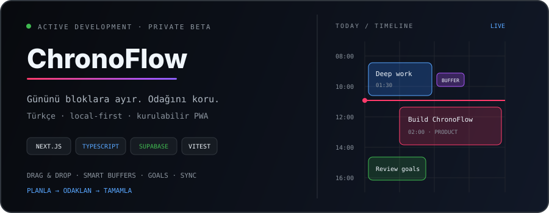
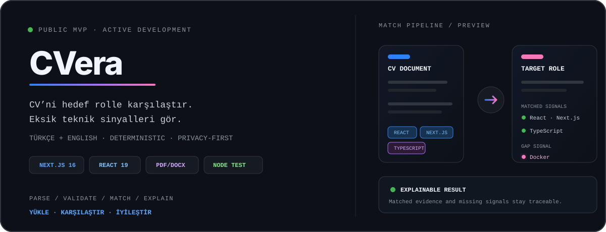

 

  

  

---

## ABOUT

I'm a developer interested in building useful software, developer tools, and thoughtful web products.

I enjoy turning repetitive workflows into focused tools, simplifying complex systems, and creating products that feel as good to use as they are to build.

My interests span web development, Python tooling, automation, software security, and local-first applications.

**My philosophy:** Build with intention. Keep things simple. Make every detail count.

 

---

## TECH STACK

### FRONTEND & INTERFACES

  

### BACKEND & DATA

  

### SYSTEMS & DEVELOPER TOOLS

---

## OPEN SOURCE LAB

SMALL TOOLS · CLEAR PURPOSE · LESS FRICTION

<table>
<tr>
<td width="50%" valign="top">

<h3>🌲 <a href="https://github.com/umutgungorr/porttree">PortTree</a></h3>

**Understand what's using your ports.**

Maps open ports to process trees, working directories, Git branches, and Docker proxy processes.

`Python` `CLI` `Diagnostics`

</td>
<td width="50%" valign="top">

<h3>⚡ <a href="https://github.com/umutgungorr/logshrink">LogShrink</a></h3>

**Less log noise. More signal.**

Filters repetitive terminal output and makes useful errors easier to find.

`Python` `CLI` `Logging`

</td>
</tr>
<tr>
<td width="50%" valign="top">

<h3>🩺 <a href="https://github.com/umutgungorr/repopulse">RepoPulse</a></h3>

**See the hidden health of a repository.**

Analyzes Git history to surface maintenance risks, code hotspots, and knowledge concentration.

`Python` `Git` `Code Health`

</td>
<td width="50%" valign="top">

<h3>💊 <a href="https://github.com/umutgungorr/envdoctor">EnvDoctor</a></h3>

**Keep environment configuration in sync.**

Validates environment contracts and helps identify missing variables and configuration drift.

`Python` `Configuration` `Security`

</td>
</tr>
</table>

---

## SECURITY & CODE INTEGRITY

<table>
<tr>
<td width="33%" valign="top">

### 🔗 [DeadLinkFinder](https://github.com/umutgungorr/deadlinkfinder)

Checks Markdown and reStructuredText links, images, and heading anchors.

`DOCUMENTATION` `MARKDOWN` `SARIF`

</td>
<td width="33%" valign="top">

### 🛡️ [TokenGuard](https://github.com/umutgungorr/tokenguard)

Helps detect accidental secret exposure in source code and Git workflows.

`SECRETS` `PRE-COMMIT` `SARIF`

</td>
<td width="33%" valign="top">

### 🔒 [PySentinel](https://github.com/umutgungorr/pysentinel)

Python AST-based static security analysis.

`PYTHON` `AST` `CODE SECURITY`

</td>
</tr>
</table>

---

## PRODUCTS & EXPERIMENTS

### ChronoFlow

A local-first daily planning experience built around focus, simplicity, and control.

| LOCAL-FIRST | OPTIONAL SYNC | TESTED CORE |
|:---:|:---:|:---:|
| Core experience without requiring an account | Optional Supabase synchronization | Core planning logic tested with Vitest |

 

### CVera

A privacy-conscious resume-to-job matching tool designed to make matching results clear and explainable.

| PRIVACY | EXPLAINABILITY | INPUT VALIDATION |
|:---:|:---:|:---:|
| In-memory document processing | Visible matched and missing requirements | Defensive file and input checks |

---

## GITHUB ACTIVITY

 

---

## ENGINEERING PRINCIPLES

<table>
<tr>
<td align="center" width="25%">

**01**

Simplicity

</td>
<td align="center" width="25%">

**02**

Reliability

</td>
<td align="center" width="25%">

**03**

Privacy

</td>
<td align="center" width="25%">

**04**

Purpose

</td>
</tr>
</table>

Build useful things. Reduce unnecessary complexity. Keep improving.

---

## LET'S CONNECT

**Have an interesting problem? Let's build something useful.**

 

  

  

DESIGNED WITH INTENTION · BUILT WITH CURIOSITY

