<div align="center">

<picture>
  <source media="(prefers-color-scheme: dark)" srcset="./assets/header.svg" />
  <source media="(prefers-color-scheme: light)" srcset="./assets/header-light.svg" />
  
</picture>

<p align="center">
  <a href="https://umutgungorr.com/"><strong>🌐 umutgungorr.com — Official Portfolio &amp; Case Studies</strong></a><br />
  <sub>Software Engineer building zero-dependency CLI diagnostics, high-velocity developer tooling, and modern web applications.</sub>
</p>

<p align="center">
  <a href="https://pypi.org/user/umutgngr/"></a>
  <a href="https://github.com/marketplace?type=actions&amp;query=umutgungorr"></a>
  <a href="https://github.com/umutgungorr?tab=repositories"></a>
  <a href="https://github.com/umutgungorr"></a>
  <a href="https://docs.oasis-open.org/sarif/sarif/v2.1.0/sarif-v2.1.0.html"></a>
</p>

</div>

---

## ⚡ `whoami`

<picture>
  <source media="(prefers-color-scheme: dark)" srcset="./assets/terminal.svg" />
  <source media="(prefers-color-scheme: light)" srcset="./assets/terminal-light.svg" />
  
</picture>

---

## 🚀 `FEATURED FLAGSHIP TOOLS & APPLICATIONS`

A curated suite of **zero-external-dependency**, high-velocity developer tools and applications built to diagnose system friction, automate workflows, and deliver delightful developer ergonomics:

<table>
  <tr>
    <td width="50%" align="center">
      🌲 <strong><a href="https://github.com/umutgungorr/porttree">PortTree</a></strong><br />
      <sub>Dev socket tree scanner &amp; Docker proxy unmasker.</sub><br /><br />
      <a href="https://pypi.org/project/porttree/"></a>
      <a href="https://github.com/umutgungorr/porttree/actions"></a>
      <a href="https://github.com/marketplace/actions/porttree-port-collision-socket-inspector"></a>
      <br /><br />
      <sub>Maps open ports to full process hierarchies, Git branches, and CWDs. Unmasks opaque <code>docker-proxy</code> containers and safely kills zombie worker trees.</sub><br />
      <sub><code>uvx porttree 3000</code> · <code>uvx porttree free 3000 -y</code></sub>
    </td>
    <td width="50%" align="center">
      ⚡ <strong><a href="https://github.com/umutgungorr/logshrink">LogShrink</a></strong><br />
      <sub>Zero-config CLI terminal stream noise filter &amp; log deduplicator.</sub><br /><br />
      <a href="https://pypi.org/project/logshrink/"></a>
      <a href="https://github.com/umutgungorr/logshrink/actions"></a>
      <a href="https://github.com/marketplace/actions/logshrink-ci-log-cleaner"></a>
      <br /><br />
      <sub>Deduplicates repetitive healthcheck floods into live counter badges like <code>[x480 suppressed]</code>. Auto-boxes multi-line stack traces in real time.</sub><br />
      <sub><code>uvx logshrink</code> · <code>pip install logshrink</code></sub>
    </td>
  </tr>
  <tr>
    <td width="50%" align="center">
      🛡️ <strong><a href="https://github.com/umutgungorr/tokenguard">TokenGuard</a></strong><br />
      <sub>Git pre-commit secret scanner &amp; SARIF security gate.</sub><br /><br />
      <a href="https://pypi.org/project/tokenguard-cli/"></a>
      <a href="https://github.com/umutgungorr/tokenguard/actions"></a>
      <a href="https://github.com/marketplace/actions/tokenguard-secret-scanner"></a>
      <br /><br />
      <sub>Scans staged files for high-entropy secrets, API keys, and cloud tokens with zero dependencies. Exports native SARIF reports for GitHub Code Scanning.</sub><br />
      <sub><code>pip install tokenguard-cli</code> · <code>tokenguard scan</code></sub>
    </td>
    <td width="50%" align="center">
      🩺 <strong><a href="https://github.com/umutgungorr/repopulse">RepoPulse</a></strong><br />
      <sub>Git forensic health &amp; knowledge silo audit engine.</sub><br /><br />
      <a href="https://pypi.org/project/git-repopulse/"></a>
      <a href="https://github.com/umutgungorr/repopulse/actions"></a>
      <a href="https://github.com/umutgungorr/repopulse"></a>
      <br /><br />
      <sub>Mines Git commit history in &lt;20ms to detect single-author bus factor risks, identify bug hotspots, calculate churn, and compute a 0–100 repository health score.</sub><br />
      <sub><code>pip install git-repopulse</code> · <code>repopulse audit</code></sub>
    </td>
  </tr>
  <tr>
    <td width="50%" align="center">
      💊 <strong><a href="https://github.com/umutgungorr/envdoctor">EnvDoctor</a></strong><br />
      <sub>.env contract linter, secret-safe synchronizer &amp; drift auditor.</sub><br /><br />
      <a href="https://pypi.org/project/envdoctor-cli/"></a>
      <a href="https://github.com/umutgungorr/envdoctor/actions"></a>
      <a href="https://github.com/umutgungorr/envdoctor"></a>
      <br /><br />
      <sub>Validates environment contracts against schemas, auto-populates <code>.env.example</code> with intelligent masked placeholders, and prevents configuration drift.</sub><br />
      <sub><code>pip install envdoctor-cli</code> · <code>envdoctor check</code></sub>
    </td>
    <td width="50%" align="center">
      🔗 <strong><a href="https://github.com/umutgungorr/deadlinkfinder">DeadLinkFinder</a></strong><br />
      <sub>Markdown &amp; rST link, image, and heading-anchor integrity verifier.</sub><br /><br />
      <a href="https://pypi.org/project/deadlinkfinder/"></a>
      <a href="https://github.com/umutgungorr/deadlinkfinder/actions"></a>
      <a href="https://github.com/marketplace/actions/deadlinkfinder-documentation-link-checker"></a>
      <br /><br />
      <sub>Offline verification of documentation links, image assets, and GitHub heading anchors with community rST support and SARIF v2.1.0 fingerprints.</sub><br />
      <sub><code>pip install deadlinkfinder</code> · <code>deadlinkfinder check</code></sub>
    </td>
  </tr>
</table>

---

### 💻 Instant CLI Execution (No Install Needed)

You can run any of my CLI tools directly via `uvx`:

```bash
# 1. Unmask Docker proxies and see which process holds port 3000
uvx porttree 3000

# 2. Kill a zombie process tree and reclaim the port safely
uvx porttree free 3000 -y

# 3. Suppress noisy terminal logs and deduplicate repetitive outputs
uvx logshrink -- npm test

# 4. Check documentation for broken links and dead image anchors
uvx deadlinkfinder check docs/
```

---

## 🛠️ `TECH STACK & ECOSYSTEM`

<div align="center">

<p><strong>Languages &amp; Runtimes</strong></p>
<a href="https://skillicons.dev"></a>

<br /><br />

<p><strong>Frontend &amp; UI Architecture</strong></p>
<a href="https://skillicons.dev"></a>

<br /><br />

<p><strong>Backend, Cloud &amp; Storage</strong></p>
<a href="https://skillicons.dev"></a>

<br /><br />

<p><strong>Developer Tooling &amp; Quality</strong></p>
<a href="https://skillicons.dev"></a>

</div>

---

## 📊 `GITHUB METRICS & INSIGHTS`

<div align="center">

<picture>
  <source media="(prefers-color-scheme: dark)" srcset="https://github-readme-stats.vercel.app/api?username=umutgungorr&amp;show_icons=true&amp;theme=github_dark&amp;hide_border=true&amp;bg_color=0d1117&amp;title_color=58a6ff&amp;text_color=c9d1d9&amp;icon_color=3fb950" />
  <source media="(prefers-color-scheme: light)" srcset="https://github-readme-stats.vercel.app/api?username=umutgungorr&amp;show_icons=true&amp;theme=default&amp;hide_border=true&amp;title_color=0969da&amp;text_color=1f2328&amp;icon_color=1a7f37" />
  
</picture>

<br /><br />

<picture>
  <source media="(prefers-color-scheme: dark)" srcset="https://github-readme-stats.vercel.app/api/top-langs/?username=umutgungorr&amp;layout=compact&amp;theme=github_dark&amp;hide_border=true&amp;bg_color=0d1117&amp;title_color=58a6ff&amp;text_color=c9d1d9" />
  <source media="(prefers-color-scheme: light)" srcset="https://github-readme-stats.vercel.app/api/top-langs/?username=umutgungorr&amp;layout=compact&amp;theme=default&amp;hide_border=true&amp;title_color=0969da&amp;text_color=1f2328" />
  
</picture>

</div>

---

## 🇹🇷 `Umut Güngör Kimdir?`

Umut Güngör, **TypeScript**, **React** ve **Python** ile modern web sistemleri, AI araçları ve açık kaynak developer araçları geliştiren **Yazılım Mühendisidir**.

* 🌐 **Web Sitesi**: [umutgungorr.com](https://umutgungorr.com/)
* 📄 **Özgeçmiş &amp; Projeler**: [umutgungorr.com/about](https://umutgungorr.com/about)
* 📦 **PyPI Paketleri**: [pypi.org/user/umutgngr](https://pypi.org/user/umutgngr/)
* 🧩 **GitHub Marketplace**: [umutgungorr Marketplace Actions](https://github.com/marketplace?type=actions&amp;query=umutgungorr)

---

## 📬 `CONNECT & COLLABORATE`

<div align="center">

**Open to focused engineering collaborations, ambitious developer tooling ideas, and high-impact teams.**

[](https://umutgungorr.com/)
[](https://www.linkedin.com/in/umut-gungor/)
[](mailto:contact.umutgungor@gmail.com)
[](https://pypi.org/user/umutgngr/)

</div>
