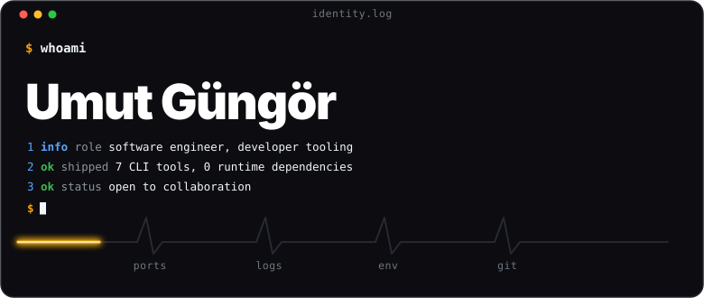
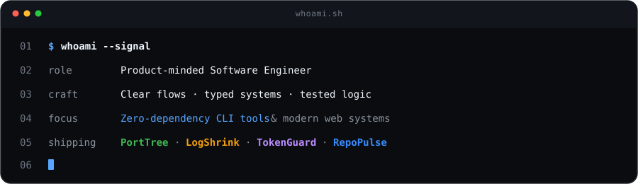
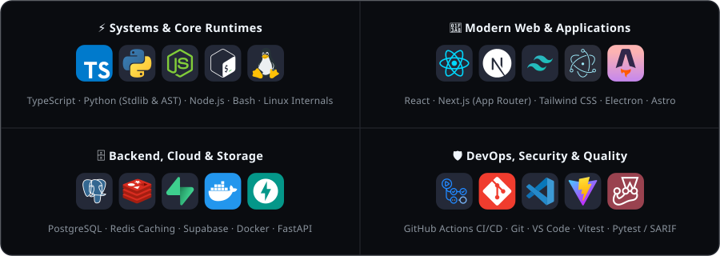
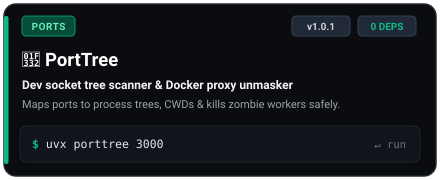
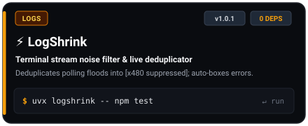
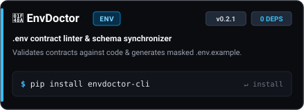
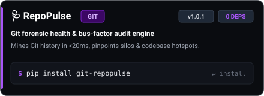
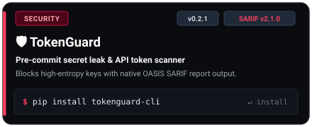
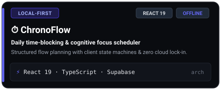

<div align="center">

<!-- Animated Identity Banner -->


<br/><br/>

<!-- Sleek Quick-Nav Action Pills -->
<p align="center">
  <a href="https://umutgungorr.com/"></a>
  <a href="https://umutgungorr.com/about"></a>
  <a href="https://pypi.org/user/umutgngr/"></a>
  <a href="https://github.com/marketplace?type=actions&query=umutgungorr"></a>
</p>

<!-- Engineering Architecture & Quality Standards -->
<p align="center">
  <a href="https://github.com/umutgungorr?tab=repositories"></a>
  <a href="https://github.com/umutgungorr"></a>
  <a href="https://docs.oasis-open.org/sarif/sarif/v2.1.0/sarif-v2.1.0.html"></a>
  <a href="https://github.com/umutgungorr"></a>
</p>

</div>

---

## 👤 `whoami --signal`

<div align="center">

<picture>
  <source media="(prefers-color-scheme: dark)" srcset="./assets/terminal.svg" />
  <source media="(prefers-color-scheme: light)" srcset="./assets/terminal-light.svg" />
  
</picture>

</div>

---

## 🛠️ Tech Stack & Systems Architecture

<div align="center">

<picture>
  <source media="(prefers-color-scheme: dark)" srcset="./assets/tech_stack.svg" />
  <source media="(prefers-color-scheme: light)" srcset="./assets/tech_stack-light.svg" />
  
</picture>

</div>

---

## 🚀 Featured Systems & Open-Source

<p>Zero-runtime-dependency developer diagnostic systems, security engines, and local-first applications:</p>

<div align="center">

<p align="center">
  <a href="https://github.com/umutgungorr/porttree">
    <picture>
      <source media="(prefers-color-scheme: dark)" srcset="./assets/card_porttree.svg" />
      <source media="(prefers-color-scheme: light)" srcset="./assets/card_porttree-light.svg" />
      
    </picture>
  </a>
  <a href="https://github.com/umutgungorr/logshrink">
    <picture>
      <source media="(prefers-color-scheme: dark)" srcset="./assets/card_logshrink.svg" />
      <source media="(prefers-color-scheme: light)" srcset="./assets/card_logshrink-light.svg" />
      
    </picture>
  </a>
</p>

<p align="center">
  <a href="https://github.com/umutgungorr/envdoctor">
    <picture>
      <source media="(prefers-color-scheme: dark)" srcset="./assets/card_envdoctor.svg" />
      <source media="(prefers-color-scheme: light)" srcset="./assets/card_envdoctor-light.svg" />
      
    </picture>
  </a>
  <a href="https://github.com/umutgungorr/repopulse">
    <picture>
      <source media="(prefers-color-scheme: dark)" srcset="./assets/card_repopulse.svg" />
      <source media="(prefers-color-scheme: light)" srcset="./assets/card_repopulse-light.svg" />
      
    </picture>
  </a>
</p>

<p align="center">
  <a href="https://github.com/umutgungorr/tokenguard">
    <picture>
      <source media="(prefers-color-scheme: dark)" srcset="./assets/card_tokenguard.svg" />
      <source media="(prefers-color-scheme: light)" srcset="./assets/card_tokenguard-light.svg" />
      
    </picture>
  </a>
  <a href="https://github.com/umutgungorr/chronoflow">
    <picture>
      <source media="(prefers-color-scheme: dark)" srcset="./assets/card_chronoflow.svg" />
      <source media="(prefers-color-scheme: light)" srcset="./assets/card_chronoflow-light.svg" />
      
    </picture>
  </a>
</p>

</div>

---

### 💻 Instant Zero-Install Quickstart

```bash
# 1. Unmask Docker proxies and inspect who holds port 3000
uvx porttree 3000

# 2. Terminate an entire zombie process tree holding port 3000
uvx porttree free 3000 -y

# 3. Deduplicate noisy CI logs and suppress repetitive healthcheck floods
uvx logshrink -- npm test

# 4. Check codebase for secret leaks with native OASIS SARIF output
pip install tokenguard-cli && tokenguard scan
```

---

## 🇹🇷 Umut Güngör Kimdir?

Umut Güngör, **TypeScript**, **React** ve **Python** ile modern web sistemleri, AI araçları ve açık kaynak developer araçları geliştiren **Yazılım Mühendisidir**.

* 🌐 **Web Sitesi**: [umutgungorr.com](https://umutgungorr.com/)
* 📄 **Özgeçmiş &amp; Projeler**: [umutgungorr.com/about](https://umutgungorr.com/about)
* 📦 **PyPI Paketleri**: [pypi.org/user/umutgngr](https://pypi.org/user/umutgngr/)
* 🧩 **GitHub Marketplace**: [umutgungorr Actions](https://github.com/marketplace?type=actions&query=umutgungorr)

---

## 📬 Connect & Collaborate

<div align="center">

**Open to focused engineering collaborations, ambitious developer tooling ideas, and high-impact teams.**

<br/>

[](https://umutgungorr.com/)
[](https://www.linkedin.com/in/umut-gungor/)
[](mailto:contact.umutgungor@gmail.com)
[](https://pypi.org/user/umutgngr/)

</div>
